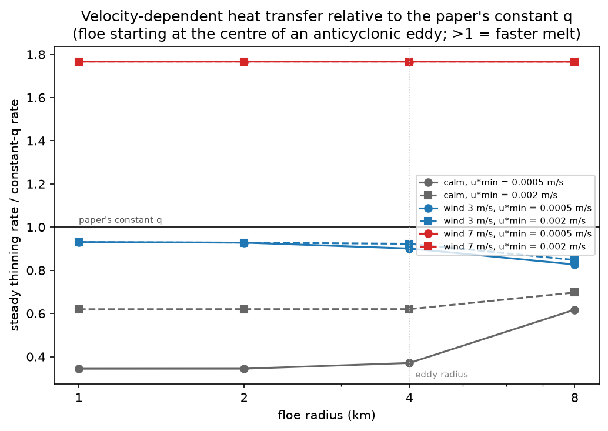
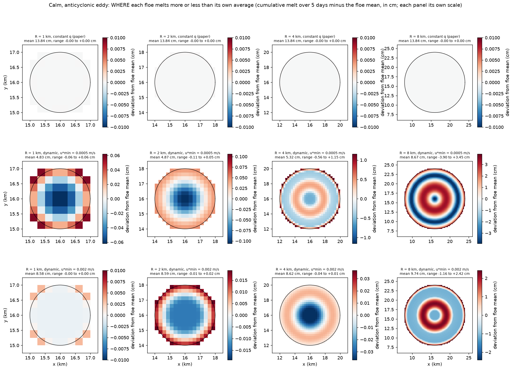
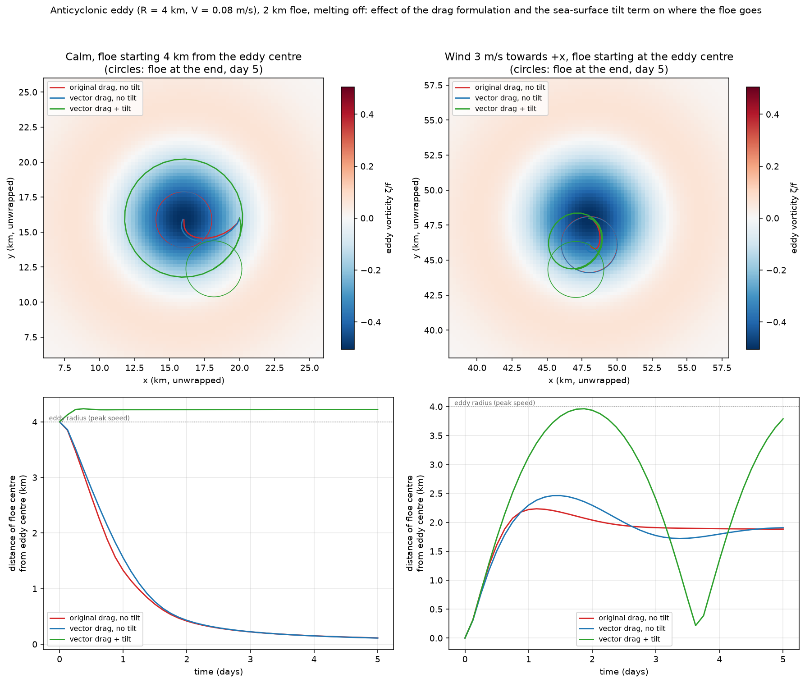

# floe-standalone-lab

Short exploratory experiments with the discrete-element sea-ice floe model
**FloeModule.jl** of Gupta & Thompson (2022), with a prescribed (non-evolving) ocean
and atmosphere. Main question: **how does ice–ocean heat transfer that depends on the
local ice–ocean velocity difference change the melt of a floe carried by an ocean eddy?**

**Full details** (model changes, parameters, every experiment, limitations):
[DETAILS.md](DETAILS.md)

**Author details:** Claude wrote it. Jayasankar T. Pillai kept asking “but why?” until it was right.
(Division of labour and credit: see [DETAILS.md](DETAILS.md).)

## What was done

- Kept Gupta's original module unmodified and made an extended copy with
  vector quadratic drag (Eq. 2 of the paper), two collision fixes, and an optional
  velocity-dependent heat transfer q = ρₒ c_p c_h u\*, with u\* = max(√C_io |Δ**u**|, u\*_min)
  (ρₒ ocean density, c_p seawater heat capacity, c_h heat transfer coefficient,
  C_io ice–ocean drag coefficient, |Δ**u**| local ice–ocean speed difference,
  u\*_min minimum friction velocity).
- Added Coriolis, prescribed eddies and winds, and an optional sea-surface tilt term
  in a separate driver.
- Checked the set-up against hand calculations: free-drift deflection ≈12° from the
  wind; melt rate 2.77 cm/day with the paper's constant heat transfer; a floe at the
  eddy centre stays there.

## Main results

**1. In calm conditions, the melt is set by the assumed minimum turbulence.** A floe
carried by an anticyclonic eddy moves almost with the water, so it melts 30–65% more
slowly than with the constant heat transfer, at a rate set by u\*_min, a number the model
has to assume. With 3 m/s wind the melt is close to the constant-q rate; at 7 m/s it is
~1.8× faster.



**2. Floes larger than the eddy melt in rings.** Floes that cannot follow the eddy's
sheared flow as a rigid body receive heat mainly where floe and water move at different
speeds (±45% around the mean for a floe twice the eddy's size).



**3. The sea-surface tilt term matters for where floes go, but little for melt.**
Without it, a floe in calm conditions spirals into the anticyclone; with it, the floe
stays at its starting radius. At 3 m/s the floe stays in the eddy either way, and the
melt changes by ~6%.



**Caveat:** the ocean is prescribed (fixed temperature and currents, no meltwater
feedback), so these results show directions and relative sizes, not realistic melt
rates. The natural next step is coupling to an evolving ocean (e.g. Oceananigans.jl),
which would set the under-ice turbulence instead of assuming it.

## Quick start

```julia
include("setup.jl")                                       # first time only
include("scripts/run_calm_heat_experiments_with_eddy.jl") # or any scripts/run_*.jl
```
```
python plotting/plot_calm_heat_experiments_with_eddy.py   # matching plot script
```
See [DETAILS.md](DETAILS.md) for the Python set-up and the list of all scripts.

## Credit and licence

`src/FloeModule.jl`: original code by Mukund Gupta, *Sea Ice Circular Floe Code* (v1),
Zenodo, https://doi.org/10.5281/zenodo.6578706 (CC-BY-4.0), used in Gupta, M., &
Thompson, A. F. (2022), *J. Geophys. Res. Oceans*, 127, e2022JC018894,
https://doi.org/10.1029/2022JC018894. `src/FloeModuleExt.jl` is a modified copy
(CC-BY-4.0). All other code: MIT License, © 2026 Jayasankar T. Pillai (see `LICENSE`).
